# Awesome Omnichannel Marketing Engagement 🚀

<div align="center">

<a href="https://github.com/ishandutta2007/Awesome-Awesome-Awesome"></a><a href="https://discord.gg/jc4xtF58Ve"></a>
<a href="https://github.com/ishandutta2007/Awesome-Omnichannel-Marketing-Engagement/stargazers"></a>
<a href="https://github.com/ishandutta2007/Awesome-Omnichannel-Marketing-Engagement/network/members"></a>
<a href="https://github.com/ishandutta2007/Awesome-Omnichannel-Marketing-Engagement/issues"></a>
<a href="https://github.com/ishandutta2007/Awesome-Omnichannel-Marketing-Engagement/blob/main/LICENSE"></a>
<a href="https://github.com/ishandutta2007"></a>

</div>

<p align="center">
  
</p>

<p align="center">
  <strong>A curated directory of top Omnichannel Marketing Engagement platforms, customer messaging architectures, behavioral journey automation tools, and developer-first notification APIs.</strong>
</p>

<p align="center">
  Explore enterprise cloud SaaS leaders alongside sovereign self-hosted open-source alternatives for email, SMS, push notifications, in-app messaging, WhatsApp, and real-time event triggers.
</p>

---

## 📑 Table of Contents
- [📊 Sector Overview & Market Dynamics](#-sector-overview--market-dynamics)
- [☁️ SaaS & Hosted Platforms](#️-saas--hosted-platforms)
- [🔓 Open-Source GitHub Projects](#-open-source-github-projects)
- [🛠️ Architecture & Integration Guide](#️-architecture--integration-guide)
- [🤝 How to Contribute](#-how-to-contribute)
- [💖 Support](#-support)
- [📈 Star History](#-star-history)
- [📜 Disclaimer](#-disclaimer)

---

## 📊 Sector Overview & Market Dynamics

The global **Omnichannel Marketing Engagement and Customer Journey Automation** market is estimated at **$22.5 billion in 2026** (projected to reach **$38.2 billion by 2030**, growing at a **14.2% CAGR**).

Market dynamics reflect a **moderately fragmented yet polarizing landscape**:
- **Enterprise Conglomerates & Public Category Leaders**: Mega-platforms (Salesforce Marketing Cloud, Braze, Klaviyo) dominate high-scale enterprise and D2C commerce through extensive ecosystem lock-in, proprietary customer data integrations, and advanced predictive AI capabilities.
- **Modern Developer & Privacy-First Disrupters**: High switching costs and surging notification volumes have simultaneously spurred intense market fragmentation, fueling rapid adoption of developer-centric notification engines, headless orchestration tools, and sovereign open-source stacks (such as Novu, Dittofeed, and Mautic) that eliminate per-message SaaS markups and preserve strict data sovereignty.

---

## ☁️ SaaS & Hosted Platforms

A comprehensive comparison of the top commercial Omnichannel Customer Engagement & Messaging platforms, sorted descending by company scale (market capitalization / valuation / annual revenue).

| Platform | Company Scale (Valuation / Revenue) | Description | Key Channels | Starting Price | Free Tier / Trial Limits |
| :--- | :--- | :--- | :--- | :--- | :--- |
| **[Salesforce Marketing Cloud](https://www.salesforce.com/marketing/)** | ~$280B Market Cap (~$38B ARR) | Enterprise-grade omnichannel marketing automation with Journey Builder, predictive audience modeling, and synchronized ad networks. | Email, SMS, Mobile Push, Group Messaging, Web, Ads | $1,250/month (Growth edition billed annually) | 30-day guided interactive trial sandbox with sample datasets (no permanent free tier) |
| **[Klaviyo](https://www.klaviyo.com/)** | ~$7.5B Market Cap (~$930M ARR) | E-commerce-native intelligent marketing automation platform powered by predictive analytics, event tracking, and personalized flows. | Email, SMS, Mobile Push, Web Forms, Reviews | $20/month (up to 500 active contacts & 5,000 monthly email sends) | Free plan: up to 250 active profiles, 500 monthly email sends, and 150 SMS/MMS credits |
| **[Braze](https://www.braze.com/)** | ~$3.8B Market Cap (~$590M ARR) | Leading real-time cross-channel customer engagement platform built for mobile-first scale, dynamic canvas journeys, and live streaming data. | Mobile Push, In-App Messages, Content Cards, Email, SMS, WhatsApp, Web Push | ~$2,500/month (~$30,000/year base annual contract) | 14-day proof-of-concept enterprise demo environment upon sales qualification (no self-serve free tier) |
| **[Insider](https://useinsider.com/)** | ~$2.0B Valuation (~$200M ARR) | AI-led individual customer journey orchestrator connecting cross-channel personalization across web, mobile apps, and messaging apps. | Web Personalization, Mobile App, WhatsApp, SMS, Email, Push | ~$1,500/month (annual commitments based on monthly active users) | 14-day guided proof-of-concept sandbox trial upon enterprise qualification (no permanent free tier) |
| **[CleverTap](https://clevertap.com/)** | ~$1.2B Valuation (~$110M ARR) | AI-powered customer retention and customer lifetime value optimization platform featuring real-time mobile behavioral analytics. | Push Notifications, In-App, WhatsApp, SMS, Email, Web Popups | ~$1,200/month (starts at custom tiers for up to 100k Monthly Active Users) | 30-day full-feature trial for up to 20,000 Monthly Active Users (MAUs) |
| **[Airship](https://www.airship.com/)** | ~$600M Valuation (~$120M ARR) | Mobile app experience and customer engagement platform specializing in high-throughput push notifications and native in-app experiences. | Mobile Push, In-App Experiences, Stories, SMS, Email, Mobile Wallet | ~$1,000/month (Axtra / Enterprise starter tiers billed annually) | 30-day proof-of-concept trial with up to 10,000 test push notifications (no permanent free tier) |
| **[OneSignal](https://onesignal.com/)** | ~$500M Valuation (~$60M ARR) | Ubiquitous messaging and push notification platform powering multi-platform push delivery, in-app messaging, and automated journeys. | Web Push, Mobile Push, In-App Messages, Email, SMS | $9/month base + $3 per 1,000 live subscribers (Growth Plan) | Free plan: up to 10,000 web push subscribers, unlimited mobile push subscribers, standard delivery speed |
| **[Customer.io](https://customer.io/)** | ~$450M Valuation (~$55M ARR) | Behavioral messaging platform for growth teams to craft complex, event-driven workflows, multi-branch journeys, and personalized transactional emails. | Email, In-App, Push Notifications, SMS, Webhooks, Ad Audiences | $100/month (Essentials plan covering up to 5,000 profiles & 1M monthly emails) | 14-day full-feature trial with up to 1,000 test profiles and full visual workflow access |
| **[MoEngage](https://www.moengage.com/)** | ~$400M Valuation (~$65M ARR) | Insights-driven customer engagement platform equipped with Sherpa AI to predict user churn, send automated alerts, and optimize journeys. | Push, Email, SMS, WhatsApp, In-App, Web Personalization, RCS | ~$950/month (Starts across Starter / Growth tiers based on active profile volume) | Free trial: 30 days access supporting up to 10,000 tracked monthly active users |
| **[Iterable](https://iterable.com/)** | ~$350M Valuation (~$150M ARR) | Unified customer engagement engine that powers cross-channel campaigns, AI journey frequency optimization, and real-time audience sync. | Email, Push Notifications, SMS, In-App, Embedded Messaging, Web | ~$1,500/month (~$18,000/year contract starting threshold) | 14-day guided proof-of-concept trial through enterprise demo environment (no permanent free tier) |
| **[Omnisend](https://www.omnisend.com/)** | ~$250M Valuation (~$45M ARR) | Purpose-built omnichannel marketing automation platform for e-commerce storefronts (Shopify, WooCommerce, BigCommerce) with prebuilt flows. | Email, SMS, Web Push, Popups, Dynamic Discount Codes | $16/month (Standard plan covering up to 500 contacts and 6,000 monthly emails) | Free plan: up to 250 contacts, 500 emails/month, 60 international SMS credits, and unlimited web push |

---

## 🔓 Open-Source GitHub Projects

Curated self-hosted and open-source customer messaging systems, notification infrastructures, marketing automation engines, and customer engagement platforms.

> **Sorted descending by GitHub stargazer count.** Badges link directly to each project's stargazers community.

| Project & Repository | GitHub_Stars | Description & Capabilities | Primary Tech Stack | License |
| :--- | :--- | :--- | :--- | :--- |
| **[Novu](https://github.com/novuhq/novu)** | [](https://github.com/novuhq/novu/stargazers) | Open-source notification infrastructure and workflow orchestration engine. Provides unified APIs across Email, SMS, Push, Chat, and In-App notification centers with subscriber preference management. | TypeScript, NestJS, React, Redis, MongoDB | MIT |
| **[Chatwoot](https://github.com/chatwoot/chatwoot)** | [](https://github.com/chatwoot/chatwoot/stargazers) | Open-source omnichannel customer engagement suite and live messaging platform. Connects customer conversations across Website Live Chat, WhatsApp, Twitter, Facebook, Email, and SMS into a unified inbox. | Ruby on Rails, Vue.js, PostgreSQL, Redis | MIT |
| **[Activepieces](https://github.com/activepieces/activepieces)** | [](https://github.com/activepieces/activepieces/stargazers) | Open-source workflow automation platform and customer journey connector. Automates multi-channel marketing actions, audience enrichment, and triggers across 200+ applications and messaging webhooks. | TypeScript, Node.js, Angular, PostgreSQL | MIT |
| **[Listmonk](https://github.com/knadh/listmonk)** | [](https://github.com/knadh/listmonk/stargazers) | High-performance, self-hosted newsletter, subscriber management, and multi-channel campaign engine. Capable of processing tens of thousands of messages per second with minimal compute overhead. | Go, PostgreSQL, Vue.js | AGPL-3.0 |
| **[Mautic](https://github.com/mautic/mautic)** | [](https://github.com/mautic/mautic/stargazers) | World's largest open-source marketing automation platform. Provides visual multi-channel campaign builders, lead scoring, drip journeys, landing pages, and comprehensive CRM contact synchronization. | PHP, Symfony, MySQL, Twig | GPL-3.0 |
| **[Plunk](https://github.com/useplunk/plunk)** | [](https://github.com/useplunk/plunk/stargazers) | Open-source, developer-friendly email marketing and transactional platform built around AWS SES. Offers visual event triggers, automated email sequences, and high-deliverability routing. | TypeScript, Next.js, Tailwind CSS, Prisma | MIT |
| **[Dittofeed](https://github.com/dittofeed/dittofeed)** | [](https://github.com/dittofeed/dittofeed/stargazers) | Developer-centric, open-source omnichannel customer engagement platform. Directly coordinates user journeys across Email, SMS, Mobile Push, WhatsApp, and Slack with event-based segmentation and ClickHouse analytics. | TypeScript, Temporal, Node.js, ClickHouse | MIT |
| **[Laudspeaker](https://github.com/laudspeaker/laudspeaker)** | [](https://github.com/laudspeaker/laudspeaker/stargazers) | Open-source customer engagement and onboarding platform. Features a graphical canvas journey builder for event-triggered messaging across Email, Push, SMS, and In-App channels. | TypeScript, Node.js, React, PostgreSQL | AGPL-3.0 |
| **[Kuzzle](https://github.com/kuzzleio/kuzzle)** | [](https://github.com/kuzzleio/kuzzle/stargazers) | Open-source multi-protocol backend and IoT/mobile event router. Enables real-time pub/sub notifications, geo-fenced marketing triggers, and event streams across connected client devices. | Node.js, C++, Elasticsearch, Redis | Apache-2.0 |
| **[Parcelvoy](https://github.com/parcelvoy/platform)** | [](https://github.com/parcelvoy/platform/stargazers) | Open-source multi-channel marketing automation system. Features drag-and-drop journey orchestrators, unified customer profiles, dynamic audience segmentation, and multi-provider delivery integrations. | TypeScript, React, Node.js, PostgreSQL | Apache-2.0 |
| **[Fusion](https://github.com/fusion-hq/fusion)** | [](https://github.com/fusion-hq/fusion/stargazers) | Lightweight open-source product analytics and user engagement tool. Unifies live in-app chat, user behavior tracking, push notifications, and lifecycle communication triggers. | TypeScript, Node.js, React, MongoDB | MIT |
| **[Perfecty Push](https://github.com/perfectyorg/perfecty-push-wp)** | [](https://github.com/perfectyorg/perfecty-push-wp/stargazers) | Self-hosted web push notification server and WordPress integration. Provides GDPR-compliant browser notification delivery without sharing audience data with external third parties. | PHP, JavaScript, Service Workers, MySQL | GPL-2.0 |
| **[Helio](https://github.com/achref-soua/helio)** | [](https://github.com/achref-soua/helio/stargazers) | AI-native open-source growth platform that unifies Customer Data Platform (CDP) capabilities, cross-channel journey building, and predictive lead scoring on top of Temporal. | Python, TypeScript, Temporal, PostgreSQL | AGPL-3.0 |

---

## 🛠️ Architecture & Integration Guide

Building a modern, sovereign, and cost-effective omnichannel engagement infrastructure using open-source building blocks:

```
                  ┌──────────────────────────────────────────────┐
                  │   Customer Touchpoints & Event Ingestion     │
                  │   (Web, Mobile Apps, Backend APIs, Webhooks) │
                  └──────────────────────┬───────────────────────┘
                                         │
                                         ▼
                  ┌──────────────────────────────────────────────┐
                  │       Customer Data Platform (CDP) / Event   │
                  │        (PostHog / Apache Kafka / ClickHouse) │
                  └──────────────────────┬───────────────────────┘
                                         │
                                         ▼
                  ┌──────────────────────────────────────────────┐
                  │    Journey Orchestration & Segment Engine    │
                  │       (Dittofeed / Laudspeaker / Mautic)     │
                  └──────────────────────┬───────────────────────┘
                                         │
                                         ▼
                  ┌──────────────────────────────────────────────┐
                  │    Unified Notification Infrastructure (Novu)│
                  │  (Template Engine, Rate Limiting, Hierarchy) │
                  └───────┬──────────────┬──────────────┬────────┘
                          │              │              │
       ┌──────────────────┴──┐    ┌──────┴──────┐    ┌──┴──────────────────┐
       ▼                     ▼    ▼             ▼    ▼                     ▼
┌──────────────┐      ┌─────────────┐     ┌──────────────┐     ┌──────────────┐
│ Email Relay  │      │ SMS Gateway │     │ Mobile Push  │     │ Chat / Apps  │
│(SES/Postmark)│      │(Twilio/Vonage     │(FCM/APNs/OneS│     │(WhatsApp/    │
│/ Listmonk    │      │ / Telnyx)   │     │ignal Engine) │     │ Chatwoot)    │
└──────────────┘      └─────────────┘     └──────────────┘     └──────────────┘
```

1. **Notification Layer**: Deploy **[Novu](https://github.com/novuhq/novu)** to abstract delivery logic across email, SMS, push, in-app notification bells, and chat.
2. **Journey & Dynamic Segmentation**: Connect **[Dittofeed](https://github.com/dittofeed/dittofeed)** or **[Laudspeaker](https://github.com/laudspeaker/laudspeaker)** to trigger multi-step, branched flows based on user events.
3. **Conversational Support & Live Messaging**: Integrate **[Chatwoot](https://github.com/chatwoot/chatwoot)** to maintain two-way customer communication across WhatsApp, live chat, and social channels.
4. **High-Speed Email Dispatch**: Pair with **[Listmonk](https://github.com/knadh/listmonk)** or **[Plunk](https://github.com/useplunk/plunk)** for ultra-fast, low-cost broadcast and transactional emails.

---

## 🤝 How to Contribute

Contributions are warmly welcomed! Please follow these steps:

1. **Fork the repository** to your GitHub account.
2. **Create a descriptive feature branch**: `git checkout -b feature/add-new-tool`.
3. **Add or update entries** in `README.md` maintaining alphabetical or star/valuation ordering.
4. **Ensure complete details**: Include valid links, honest starting price, concrete free tier limits, company valuation or repository stars.
5. **Commit your changes**: `git commit -m "Add [Tool Name] to omnichannel engagement ecosystem"`.
6. **Submit a Pull Request** with a clear explanation of why the addition is relevant to omnichannel marketing.

---

## 💖 Support

Thank you for exploring and supporting the **Awesome Omnichannel Marketing Engagement** collection! 🌟

If you found this directory helpful in navigating customer engagement technologies:
- ⭐ **Star this repository** to help others discover it on GitHub.
- 🍴 **Fork it** to customize your company's internal marketing technology evaluation stack.
- 📢 **Share it** on LinkedIn, X/Twitter, Discord, and marketing developer communities.
- ☕ **Buy me a coffee & support continued maintenance**: Sponsor on GitHub via the [Sponsor Dashboard](https://github.com/sponsors/ishandutta2007).

---

## 📈 Star History

[](https://star-history.dera.page/#ishandutta2007/Awesome-Omnichannel-Marketing-Engagement&type=date&legend=top-left)

---

## 📜 Disclaimer

- This directory is a **community-curated educational index** and does not constitute an endorsement or commercial partnership.
- All product names, logos, and brands are property of their respective owners.
- When configuring omnichannel messaging platforms, always ensure compliance with global telecommunications and privacy standards (**GDPR**, **CCPA**, **CAN-SPAM**, **TCPA**, and **CASL**).
